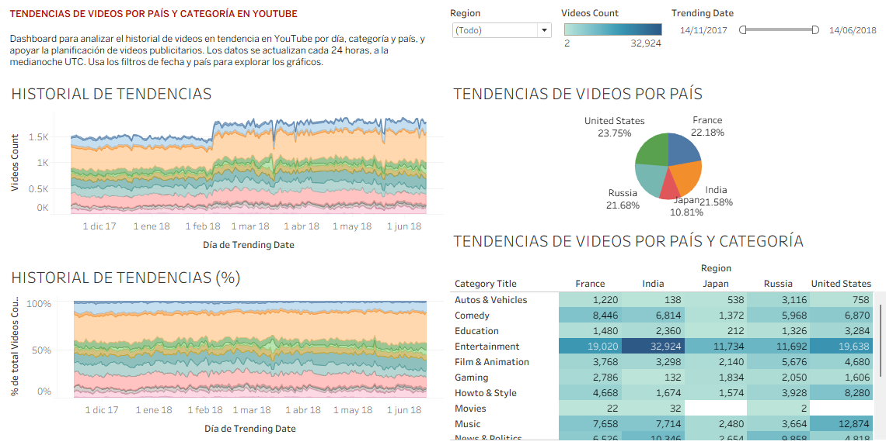

# Tendencias de videos de YouTube por país y categoría

**Proyecto de análisis de datos · TripleTen · 2026**

Autor: Angel Regino

🔗 **[Ver el dashboard interactivo en Tableau Public](https://public.tableau.com/app/profile/angel.regino/viz/TENDENCIASDEVIDEOS/Dashboard1)**

---

## 1. El problema

Los **gerentes de planificación de videos publicitarios** necesitan saber qué tipo de videos se vuelven tendencia en YouTube y en qué países, para decidir dónde y con qué contenido anunciarse.

El dashboard responde tres preguntas:
1. ¿Qué categorías estuvieron en tendencia con más frecuencia?
2. ¿Cómo se reparten los videos en tendencia entre los países?
3. ¿Qué categorías son populares en Estados Unidos y en qué se diferencian del resto?

## 2. Los datos

Tabla `trending_by_time` (base de datos `youtube`): historial diario de videos en tendencia del **14/11/2017 al 14/06/2018**, con **339 990 videos** en **5 países** (Francia, India, Japón, Rusia y Estados Unidos).

| Columna | Qué contiene |
|---|---|
| `region` | País |
| `trending_date` | Día |
| `category_title` | Categoría del video |
| `videos_count` | Cuántos videos de esa categoría estuvieron en tendencia ese día |

## 3. Lo que hice

- Diseñé un **dashboard en Tableau** pensado para gerentes, que se actualiza cada 24 horas.
- **Historial de tendencias:** gráfico de áreas apiladas con los videos en tendencia por día y categoría.
- **Reparto por país:** participación de cada país en el total.
- **Tabla de categorías por país:** para comparar Estados Unidos contra el resto.
- Publiqué el dashboard en **Tableau Public** y preparé un informe en PDF con las conclusiones.

**Herramientas:** Tableau Public

## 4. Lo que descubrí

- **Entertainment domina:** 95 008 de los 339 990 videos en tendencia (28%). Encabeza 4 de los 5 países, y en Rusia la primera categoría es People & Blogs. Las 5 categorías principales suman cerca del 70% del total.
- **El volumen está repartido entre 4 mercados:** Estados Unidos 23.75%, Francia 22.18%, Rusia 21.68% e India 21.58%. **Japón** es la excepción, con 10.81%, más o menos la mitad que los demás.
- **Estados Unidos tiene un perfil propio:** Music (12 874) y Howto & Style (8 280) pesan mucho más ahí que en cualquier otro país. En cambio, News & Politics destaca en India y Rusia.
- En febrero de 2018 el total diario sube de unos 1 500 a unos 1 800 videos en tendencia.

### Recomendaciones para la planificación publicitaria
1. **Entertainment es la apuesta más segura** en casi todos los mercados.
2. **En Estados Unidos**, además de Entertainment, conviene apostar por Music y Howto & Style.
3. **En Rusia**, People & Blogs; **en India y Rusia**, News & Politics.
4. **En Japón**, planificar considerando que tiene la mitad del volumen que los otros países.

*Nota: las cifras son videos en tendencia, no vistas.*
